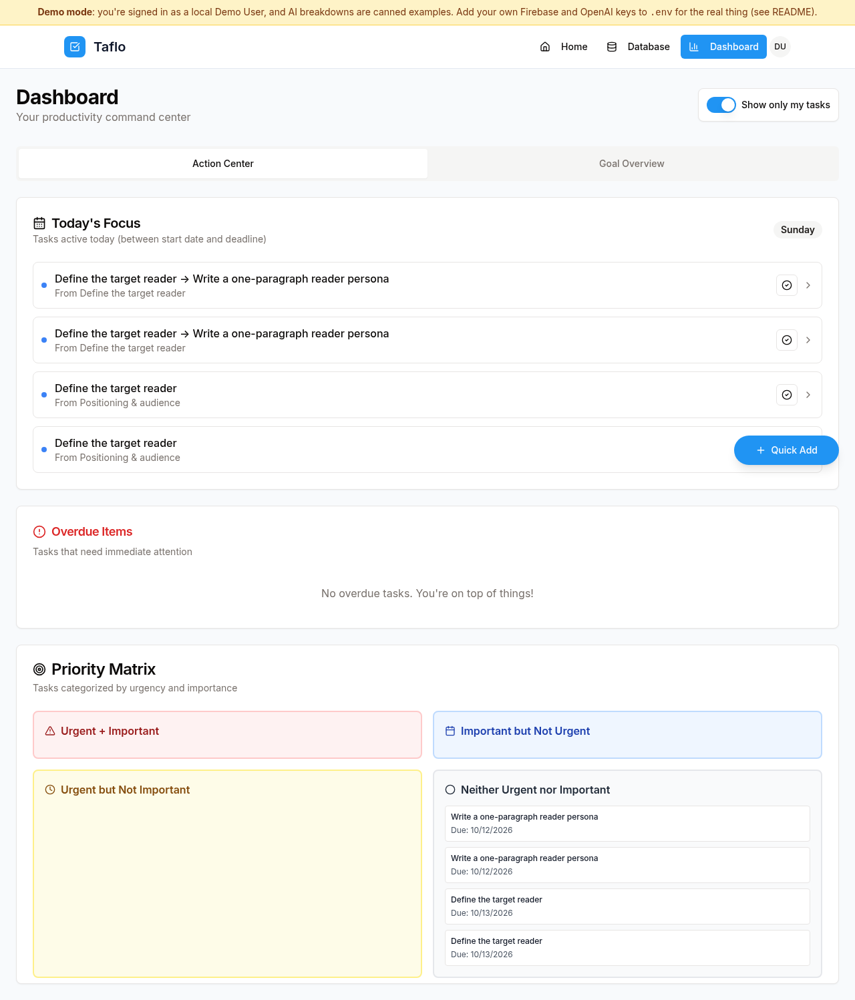

# Taflo (TaskAI) — AI task breakdown

Type a high-level goal; an AI agent breaks it into goals → projects → tasks → subtasks with priorities, due dates and time estimates, then tracks progress as you complete them.

**Why:** planning is the work nobody has time for. This puts an agent on it so you can get to doing.

 <!-- TODO: add screenshot/GIF -->

## Features
- GPT-4o breakdown of goals/tasks into structured subtasks, with an approval step before saving
- Goal → project → task → subtask hierarchy, detail pages, calendar timeline
- Progress roll-up when subtasks complete
- AI-assist services: planning assistant, research agent, content generator, task analyzer
- Firebase auth, team assignment, file upload

## Tech stack
React 18 + TypeScript, Vite, wouter, TanStack Query, Tailwind + shadcn/ui · Express (TypeScript) · PostgreSQL (Neon) + Drizzle ORM · OpenAI GPT-4o · Firebase (auth/Firestore)

## Setup
```bash
npm install
cp .env.example .env   # fill in values
npm run db:push        # drizzle-kit push: create/sync DB schema
npm run dev            # dev server on PORT (default 5000)
# production: npm run build && npm start
```

## Set up your own Firebase
TaskAI ships with no Firebase project. Bring your own:

1. Create a project at [console.firebase.google.com](https://console.firebase.google.com).
2. **Authentication** → Get started → enable **Email/Password** and **Google**. Under Settings → Authorized domains, add your dev and production domains.
3. **Firestore Database** → Create database (production mode).
4. **Project settings → Your apps → Add app → Web**. Register the app and copy the `firebaseConfig` values into `.env` as the `VITE_FIREBASE_*` variables (see `.env.example`).
5. Optional (server-side Firestore): Project settings → Service accounts → Generate new private key. Put the JSON on one line in `FIREBASE_SERVICE_ACCOUNT_KEY` and set `FIREBASE_PROJECT_ID`.

The app fails fast with a clear error listing any missing `VITE_FIREBASE_*` variables.

**Lock it down:**
- In Google Cloud Console → APIs & Services → Credentials, restrict the browser API key to your domains (HTTP referrers) and to the Identity Toolkit, Token Service and Firestore APIs.
- Use Firestore rules so each user can only read and write their own data. Example:

```
rules_version = '2';
service cloud.firestore {
  match /databases/{database}/documents {
    match /users/{userId}/{document=**} {
      allow read, write: if request.auth != null && request.auth.uid == userId;
    }
    match /{collection}/{docId} {
      allow read, update, delete: if request.auth != null && resource.data.userId == request.auth.uid;
      allow create: if request.auth != null && request.resource.data.userId == request.auth.uid;
    }
  }
}
```

## Environment variables
`DATABASE_URL`, `OPENAI_API_KEY`, `SESSION_SECRET`, `JWT_SECRET`, `FIREBASE_PROJECT_ID`, `FIREBASE_PRIVATE_KEY`, `FIREBASE_CLIENT_EMAIL`, `VITE_FIREBASE_API_KEY`, `VITE_FIREBASE_AUTH_DOMAIN`, `VITE_FIREBASE_PROJECT_ID`, `PORT`, `NODE_ENV` (see `.env.example`).

## License
MIT
